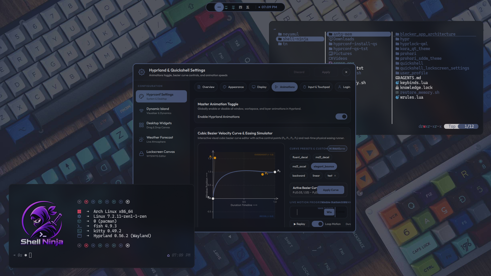
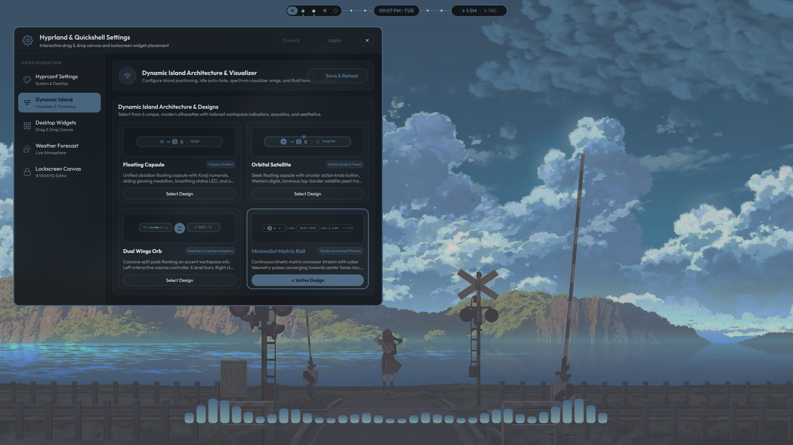
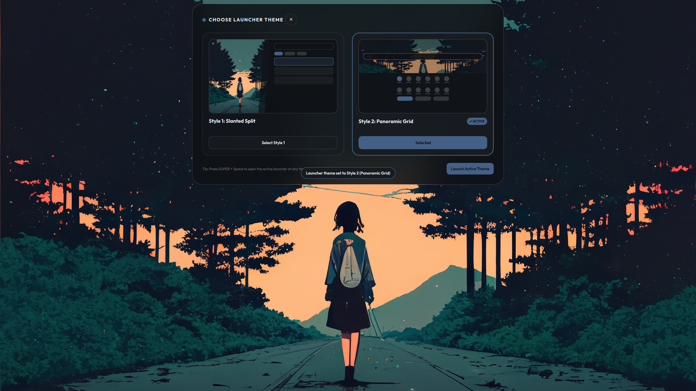
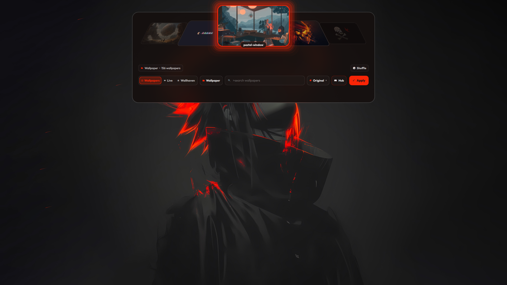
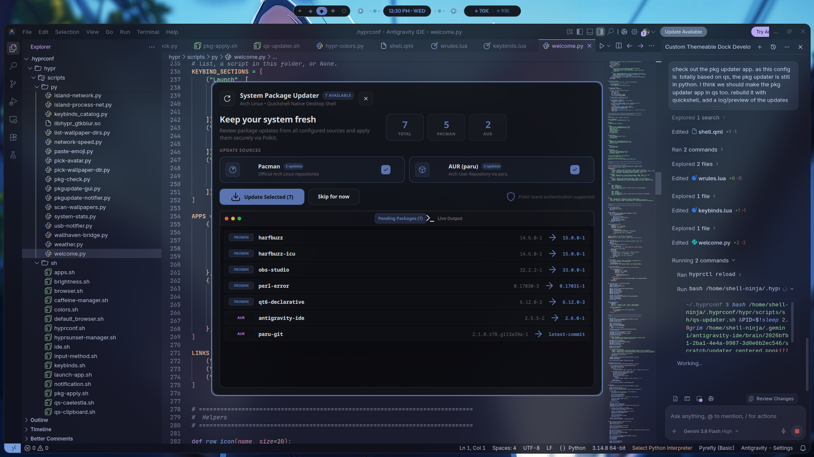
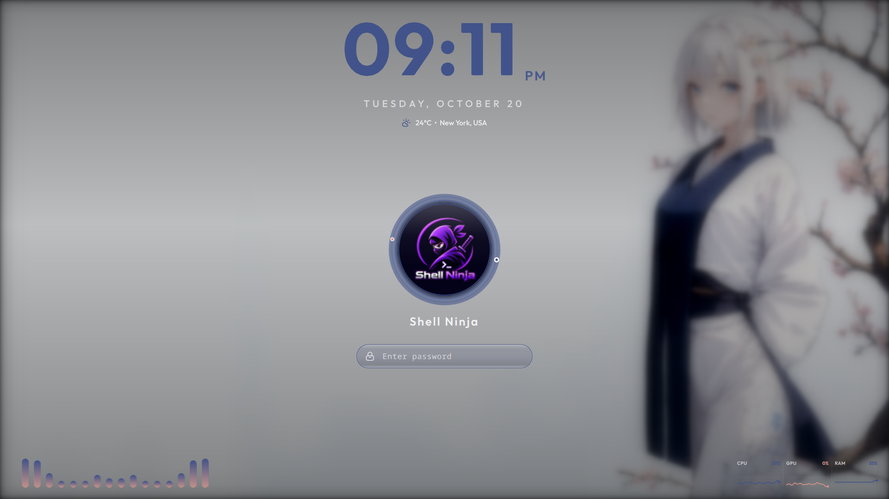

<a id="top"></a>

<h1 align="center">Hyprconf — Minimalist Obsidian Hyprland & Quickshell Desktop</h1>
<p align="center">
  <b>v1.0.1</b> &bull; Crafted by <b><a href="https://github.com/shell-ninja">Shell Ninja</a></b>
</p>

<p align="center">
  
  
  
  
</p>

<br>

A streamlined, obsidian-styled **Hyprland** desktop environment powered natively by **Quickshell**. Featuring an interactive morphing **Dynamic Island** notch, zero-latency Wayland layer shell integration, **Material You (M3) / Noctalia** wallpaper-derived color harmonizer, live video wallpapers (`mpvpaper`), and a unified system settings suite.

> [!NOTE]
> This repository contains the core dotfiles and configurations. For initial system deployment and automatic dependency installation across Arch/CachyOS/Fedora, visit the **[hyprconf-install](https://github.com/shell-ninja/hyprconf-install)** repository.

<br>

<div align="center">
  <a href="#screenshots"><kbd> Visual Showcase </kbd></a>&ensp;&ensp;
  <a href="#features"><kbd> Features </kbd></a>&ensp;&ensp;
  <a href="#shortcuts"><kbd> Shortcuts </kbd></a>&ensp;&ensp;
  <a href="#structure"><kbd> Configuration </kbd></a>&ensp;&ensp;
  <a href="#update"><kbd> Updater </kbd></a>&ensp;&ensp;
  <a href="#contributing"><kbd> Contributing </kbd></a>
</div>

<br>

---

<a id="screenshots"></a>

## Visual Showcase

### Desktop & Workspace Layout
<div align="center">
  
  
</div>

<br>

### Dynamic Island Command Center & Settings
<div align="center">
  
  
</div>

<br>

### Custom Application Launchers
<div align="center">
  
  
</div>

<br>

### Dynamic Theming & System Widgets
<div align="center">
  
  
</div>

<br>

### Morphing Lockscreen & Personalization Canvas
<div align="center">
  
  
</div>

<br>

---

<a id="features"></a>

## Key Features

### Dynamic Island (`quickshell/island`)
- **Adaptive Collapsed Notch**: Floats cleanly at top-center (or bottom dock). Shows live CAVA audio visualizer wings during playback, track titles, active workspace dots, minimal clock, and battery/network badges.
- **Morphing Dashboard**: Smooth spring physics expand the notch into a full command center:
  - **Overview**: System volume, brightness, player controls, media cover art, and quick toggles (DND, Night Light, Performance profile, Wi-Fi, Bluetooth).
  - **Status & Diagnostics**: Real-time CPU, RAM, GPU, storage metrics, and 5-day weather forecasts.
  - **Process Network Monitor**: Live per-process bandwidth and socket tracking.
- **Fullscreen Auto-Hide**: Detects when games, media players, or browser F11 fullscreen modes are active, immediately unmapping the layer shell surface and releasing the exclusive zone so games and videos enjoy 100% unimpeded display.
- **Native Polkit Agent**: Password authorization flows morph seamlessly right out of the island notch.
- **Quick Reload**: Press <kbd>Ctrl</kbd> + <kbd>Esc</kbd> anytime to restart the Island and all desktop widgets.

### Noctalia M3 Dynamic Colorscheme (`hypr-colors.py`)
- **Wallpaper Hue Clustering**: Groups wallpaper pixels into 24 discrete hue bins (15° separation) to discover contrasting color harmonies present in the image.
- **7 Authentic Variants**:
  - **Vibrant**: Highest chroma saturation boost.
  - **Muted**: Soft, calm dominant background tones.
  - **Expressive**: Contrasting secondary pop tone (≥ 50° divergent hue).
  - **Warm**: Warmest amber, copper, and coral accents found in the image.
  - **Cool**: Deep blue, cyan, and glacial teal highlights.
  - **Pastel**: Soft, luminous high-lightness accent.
  - **Original**: Natural, raw sampled dominant color.
- **System-Wide Hot Reload**: Synchronously re-themes Hyprland window borders, Kitty terminal, Neovim, GTK3/GTK4, Qt6/KDE (Dolphin), Btop, and Quickshell widgets in real time.

### Wallpaper & Live Media Selector (`quickshell/island/WallpaperView.qml`)
- **Integrated Browser**: Preview and select wallpapers directly within the expanded island.
- **Color Variant Dropdown**: Choose between the 7 Noctalia variants on the fly with live palette regeneration.
- **Live / Video Wallpapers**: Full support for `.mp4`, `.webm`, `.mkv`, and `.gif` using hardware-accelerated `mpvpaper`.
- **Wallhaven Integration**: Search and sync toplist/hot community wallpapers directly into your local library.

### Custom App Launchers (`quickshell/launcher`)
- **Style 1 (Slanted Split Quad)** & **Style 2 (Panoramic Grid)**: Fast, keyboard-navigable application launchers with live category filtering and terminal execution.
- Toggle between styles with <kbd>Super</kbd> + <kbd>Alt</kbd> + <kbd>D</kbd>.

### Dynamic Island Lockscreen (`quickshell/lockscreen`)
- Expands directly out of the Dynamic Island notch into a fullscreen obsidian lockscreen upon <kbd>Super</kbd> + <kbd>L</kbd>.
- Smooth PAM authentication with whole-theme red shake on invalid password and reverse spring collapse upon unlock.

---

<a id="shortcuts"></a>

## Essential Keyboard Shortcuts

| Shortcut | Action | Description |
|---|---|---|
| <kbd>Super</kbd> + <kbd>Return</kbd> | Terminal | Open Kitty terminal |
| <kbd>Super</kbd> + <kbd>Space</kbd> / <kbd>Super</kbd> + <kbd>D</kbd> | App Launcher | Open Quickshell application launcher |
| <kbd>Super</kbd> + <kbd>W</kbd> | Wallpaper Picker | Open Quickshell Dynamic Island wallpaper selector |
| <kbd>Ctrl</kbd> + <kbd>Esc</kbd> | **Reload Shell** | **Restart Quickshell & Dynamic Island** |
| <kbd>Super</kbd> + <kbd>F</kbd> | Fullscreen | Toggle fullscreen mode (auto-hides island) |
| <kbd>Super</kbd> + <kbd>Q</kbd> | Close Window | Close active window |
| <kbd>Super</kbd> + <kbd>E</kbd> | File Manager | Open Dolphin / Thunar |
| <kbd>Super</kbd> + <kbd>Shift</kbd> + <kbd>E</kbd> | Yazi | Open terminal file manager |
| <kbd>Super</kbd> + <kbd>V</kbd> | Float Window | Toggle active window floating state |
| <kbd>Super</kbd> + <kbd>X</kbd> | Power Menu | Open Dynamic Island power & logout menu |
| <kbd>Super</kbd> + <kbd>L</kbd> | Lock Screen | Lock screen via Quickshell island morph |
| <kbd>Print</kbd> | Screenshot | Open Quickshell screenshot studio |
| <kbd>Super</kbd> + <kbd>Shift</kbd> + <kbd>,</kbd> | Settings | Open Unified Quickshell Settings application |
| <kbd>Super</kbd> + <kbd>Shift</kbd> + <kbd>H</kbd> | Keybinds Help | Interactive keybinding search & dispatcher |

> [!TIP]
> Press <kbd>Super</kbd> + <kbd>Shift</kbd> + <kbd>H</kbd> anywhere to search all available keybindings interactively.

---

<a id="structure"></a>

## Configuration Architecture

All dotfiles reside under `~/.hyprconf/`:

```
~/.hyprconf/
├── hypr/
│   ├── hyprland.conf          # Main entrypoint loader
│   ├── configs/               # Modular Lua configurations
│   │   ├── env.lua            # Environment variables & Wayland flags
│   │   ├── exec.lua           # Autostart daemons & background processes
│   │   ├── keybinds.lua       # Keybindings & window management
│   │   ├── windowrules.lua    # Window & layer rules
│   │   └── animations.lua     # Bezier curves and animation curves
│   ├── scripts/
│   │   ├── py/hypr-colors.py  # Noctalia M3 color harmony extraction engine
│   │   └── sh/qs-reload.sh    # Quickshell & Island reload supervisor
│   └── Wallpaper/             # Static & Live wallpaper collections
├── quickshell/
│   ├── island/                # Dynamic Island notch, HUD, & WallpaperView
│   ├── launcher/              # Custom app launcher (Style 1 & 2)
│   ├── lockscreen/            # Morphing PAM lockscreen
│   ├── widgets/               # Desktop System Monitor, Weather & Visualizer
│   ├── settings/              # Unified Hyprland & Quickshell Settings app
│   └── Theme.qml              # Live-reloaded reactive theme tokens
├── kitty/                     # Terminal configs & auto-synced colorscheme
├── nvim/                      # Neovim configuration & dynamic palette
└── .version                   # Active version release tag (v1.0.0)
```

---

<a id="update"></a>

## Updates & Versioning

Hyprconf follows a clean release model (`v1.0.0+`):

- **Background Watchdog**: Runs automatically via `hyprconf.sh --daemon`, checking every 6 hours for new updates against [shell-ninja/hyprconf](https://github.com/shell-ninja/hyprconf).
- **Notifications**: When an update is detected, a desktop notification with an **"Update Now"** button and audio chime is sent.
- **Manual Update**: Run the interactive Gum-powered updater anytime:
  ```bash
  bash ~/.hyprconf/hypr/scripts/sh/hyprconf.sh
  ```

---

<a id="contributing"></a>

## Contributing

Contributions, bug reports, and suggestions are welcome!

1. Fork the repository.
2. Create a topic branch: `git checkout -b feature/my-enhancement`.
3. Commit your changes: `git commit -m "feat: Add new feature"`.
4. Push to your fork and submit a Pull Request against the `development` branch.

---

## Acknowledgements & Credits

- **[Shell Ninja](https://github.com/shell-ninja)** — Concept, design, and implementation.
- **[Quickshell](https://quickshell.outfoxxed.me/)** — Flexible Qt/QML desktop shell framework for Wayland.
