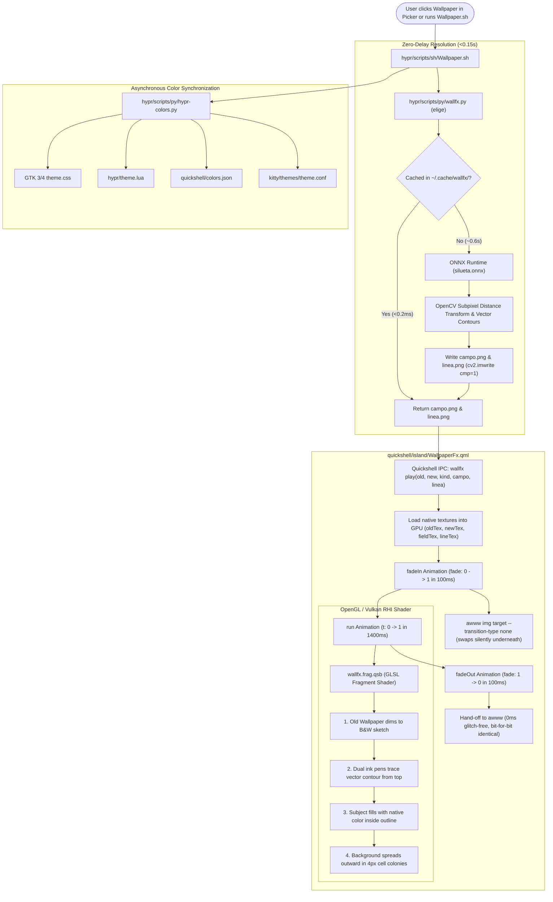

# Hyprconf Dynamic Wallpaper Transition Architecture

The Hyprconf wallpaper transition engine is a high-performance, native Wayland desktop shell effect built directly in **Quickshell (Qt6 QML)**, **GLSL shaders (Qt RHI)**, **ONNX Runtime**, and **awww**. 

Unlike standard compositor fades or sliding wipes, Hyprconf renders two mathematically distinct, content-aware transition modes directly onto a Wayland layer surface (`WlrLayer.Bottom`):
1. **Outline / Ink-Sketch Mode (`perfil`)**: When switching to a wallpaper featuring a subject (human, anime character, vehicle, or animal), the old desktop dims into a black-and-white sketch, a virtual ink pen traces the character's vector silhouette from top to bottom, the subject fills in with rich vibrant color, and the rest of the world blooms outward from the subject in organic 4px pixel colonies.
2. **Contagion / Colony Mode (`contagio`)**: When switching to pure landscapes or abstract wallpapers, a handful of pixel colonies land at randomized coordinates and eat through the old wallpaper along a 2D value-noise arrival field with ragged, burning ember edges.

---

## 1. System Architecture & Component Flow



---

## 2. File Responsibilities Matrix

| File Path | Role & Technologies | Key Functions / Responsibilities |
| :--- | :--- | :--- |
| [`config/hypr/scripts/sh/Wallpaper.sh`](file:///home/shell-ninja/.hyprconf/hypr/scripts/sh/Wallpaper.sh) | **Master Orchestrator**<br>`Bash` | • Resolves active target wallpaper & validates formats.<br>• Invokes `wallfx.py elige` via dedicated Python venv.<br>• Dispatches `quickshell ipc -c island call wallfx play ...`.<br>• Updates symlinks (`current_wallpaper.png`) & syncs system palettes via `hypr-colors.py`. |
| [`config/hypr/scripts/py/wallfx.py`](file:///home/shell-ninja/.hyprconf/hypr/scripts/py/wallfx.py) | **Computer Vision & Map Engine**<br>`Python`, `OpenCV`, `ONNX Runtime` | • `_cutout`: Fast neural segmentation using direct `silueta.onnx` tensor evaluation.<br>• `perfil`: Computes anti-aliased signed distance fields (`sd`) and vector contours (`approxPolyDP`).<br>• `contagio`: Evaluates multi-octave Dijkstra arrival cost fields.<br>• Generates 16-bit texture maps (`-campo.png` and `-linea.png`). |
| [`config/quickshell/island/WallpaperFx.qml`](file:///home/shell-ninja/.hyprconf/quickshell/island/WallpaperFx.qml) | **Desktop Surface Daemon**<br>`Qt6 QML`, `Quickshell Wayland` | • Layer surface mapped to `WlrLayer.Bottom` directly above `awww`.<br>• Exposes the `wallfx` IPC interface (`play`, `prepare`, `go`, `stop`).<br>• Controls animation timelines (`fadeIn`, `run`, `fadeOut`).<br>• Silently synchronizes the underlying `awww` wallpaper daemon during `fadeIn`. |
| [`config/quickshell/island/shaders/wallfx.vert`](file:///home/shell-ninja/.hyprconf/quickshell/island/shaders/wallfx.vert) | **RHI Vertex Shader**<br>`GLSL std140` | • Projects the fullscreen quad to the Wayland output surface.<br>• Passes interpolated texture coordinates (`qt_TexCoord0`) to the fragment stage. |
| [`config/quickshell/island/shaders/wallfx.frag`](file:///home/shell-ninja/.hyprconf/quickshell/island/shaders/wallfx.frag) | **Transition Fragment Shader**<br>`GLSL 440` | • **Mode 0 (`contagio`)**: 4px organic cellular spread, burning ember edges (`sin(PI * t)` energy), and spark jumps.<br>• **Mode 1 (`outline`)**: Grayscale desaturation, dual ink pen contour tracking, anti-aliased subpixel subject fill, and outward colony spread. |
| [`config/hypr/scripts/py/scan-wallpapers.py`](file:///home/shell-ninja/.hyprconf/hypr/scripts/py/scan-wallpapers.py) | **High-Speed Thumbnail Engine**<br>`Python`, `Pillow`, `ThreadPool` | • Scans wallpaper directories in **~78ms**.<br>• Generates and caches 400×230 JPEG thumbnails in `~/.cache/quickshell-wallpaper-panel/thumbnails/` to eliminate Qt Quick texture decoding lag in carousel cards. |
| [`config/quickshell/wallpaper/WallpaperView.qml`](file:///home/shell-ninja/.hyprconf/quickshell/wallpaper/WallpaperView.qml) | **CoverFlow Wallpaper Browser**<br>`Qt6 QML` | • 15-card 3D CoverFlow carousel UI.<br>• Displays lightweight pre-cached thumbnails on cards.<br>• Triggers `Wallpaper.sh` upon user selection. |

---

## 3. Deep Dive: The Four Stages of the Outline Shader

In [`wallfx.frag`](file:///home/shell-ninja/.hyprconf/quickshell/island/shaders/wallfx.frag), parameter $t$ progresses linearly from $0.0$ to $1.0$ over $1400\text{ ms}$:

```
  t = 0.00                                                   t = 1.00
  ┌──────────────────────────────────────────────────────────────┐
  │ 1. Dim to B&W  (t: 0.00 -> 0.18)                             │
  │ ──────►                                                      │
  │          2. Draw Ink Lines  (t: 0.02 -> 0.35)                │
  │          ──────────►                                         │
  │                    3. Fill Subject Color  (t: 0.30 -> 0.65)  │
  │                    ──────────────►                           │
  │                              4. Bloom Background (t: 0.42->0.95)
  │                              ────────────────────►           │
  └──────────────────────────────────────────────────────────────┘
```

### Stage 1: The Stage Step-Back ($t \in [0.00, 0.18]$)
The existing desktop wallpaper dims into a monochrome black-and-white sketch tone using luminance weighting:
```glsl
float back = escena(t / 0.18);
vec3 st = oldAt(uv);
st = mix(st, vec3(luma(st)), 0.85 * back) * (1.0 - 0.25 * back);
```

### Stage 2: Ink Pen Contour Tracing ($t \in [0.02, 0.35]$)
The red channel of `lineTex` encodes the parametric distance $p \in [0, 1]$ along the subject's perimeter starting at the topmost vertex. Two pens trace downwards concurrently on opposite sides:
```glsl
float drawP = escena((t - 0.02) / 0.33);
float lp = texture(lineTex, newUv(uv, 1.0)).r;
float fade = 1.0 - escena((t - 0.45) / 0.25);
if (lp > 0.0 && lp <= drawP && fade > 0.0) {
    float d = abs(sdPx) - lineW * 0.5;
    float core = clamp(0.5 - d / max(fwidth(sdPx), 1e-3), 0.0, 1.0);
    c = mix(c, ink.rgb, core * 0.75 * fade);
}
```

### Stage 3: Inside Fill ($t \in [0.30, 0.65]$)
The green channel of `fieldTex` encodes distance inward from the outline. The character fills with native color from the edges inward:
```glsl
float Ti = escena((t - 0.30) / 0.35) * 1.02 - 0.01;
vec3 cIn = texture(fieldTex, newUv(cuv, 1.0)).g <= Ti ? texture(newTex, newUv(uv, 1.0)).rgb : st;
```

### Stage 4: World Bloom ($t \in [0.42, 0.95]$)
The smooth distance field encoded in `lineTex` ($G$ and $B$ channels, 16-bit surface) triggers an outward wave of 4px pixel colonies expanding to the screen borders:
```glsl
float To = escena((t - 0.42) / 0.52) * 1.02 - 0.01;
vec3 cOut = surface(newUv(cuv, 1.0)) <= To ? texture(newTex, newUv(uv, 1.0)).rgb : st;
vec3 c = mix(cOut, cIn, inside);
```

---

## 4. Key Engineering Innovations

1. **Subpixel Anti-Aliasing & Vector Contours**:
   Raw thresholding produces 90-degree pixel staircases. `wallfx.py` resolves this by running `cv2.approxPolyDP` to create smooth polygonal vector paths and applies a continuous Gaussian blur to the signed distance field (`sd`), yielding anti-aliased subpixel boundaries in the shader.
2. **Fixed Camera (Zero-Shake Hand-off)**:
   By locking the camera to a rock-solid $z = 1.0$ and ensuring `WallpaperFx.qml` does not downsample textures with artificial bounding boxes, the shader's UV coordinates match `awww` down to the exact subpixel. When the layer surface unmaps, the transition is completely glitch-free.
3. **Background Thumbnail Caching**:
   `scan-wallpapers.py` caches 400×230 JPEG representations in `~/.cache/quickshell-wallpaper-panel/thumbnails/`. Instead of decoding 15MB 4K PNGs while scrolling, Qt Quick loads 20KB files in **<1ms**, eliminating carousel stutter.
